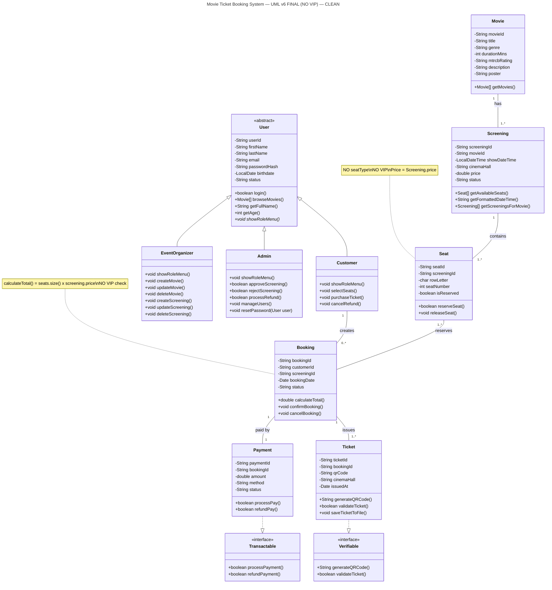

# 🎬 Movie Ticket Booking System — OOP Capstone Project

Java Swing • GUI-first • Team of 4

## Team
| Member | Role | Screens | Branch |
|---|---|---|---|
| Shima | Auth + Payment + Ticket | 4 | `person-shima-auth-payment` |
| Vance | Customer | 7 | `person-vance-customer` |
| Lance | Organizer | 5 | `person-lance-organizer` |
| Jup | Admin | 4 | `person-jup-admin` |
| **Total** | | **20** | |

## Rules
- `main` = finished / working only. **Nobody codes directly on main.**
- Work on your own branch → Push → Pull Request → Teammate reviews → Merge

## Folder Structure
```
src/
  model/      User, Customer, EventOrganizer, Admin, Movie, Screening, Seat, Booking, Payment, Ticket
  service/    AuthService, MovieService, ScreeningService, BookingService, PaymentService, UserService, SeatService
  ui/
    auth/       Login, Register
    customer/   Dashboard, Browse, Detail, Seat, Summary, MyBookings, MyProfile
    organizer/  Dashboard, ManageMovies, ManageScreenings, CreateScreening, MyScreenings
    admin/      Dashboard, ApproveScreening, Refund, ManageUsers
  util/       Theme.java
data/         .txt / .csv files (gitignored if needed)
docs/         UML, UX Board, Task Division, Senior Dev Docs
```

## How to Run
1. Open this folder in **IntelliJ IDEA**
2. Make sure JDK 17+ is selected
3. Run `src/Main.java`
4. Use IntelliJ GUI Designer `.form` files for each screen — never `new JButton()` manually

## Daily Workflow
```bash
git checkout main
git pull
git checkout person-<yourname>-<role>
git merge main
# ... code ...
git add .
git commit -m "Add Login UI - Shima"
git push
# Then: GitHub → Pull Request → Review → Merge
```

## UML



## Key Decisions
- **GUI-first:** Build all screens with dummy data first, wire logic later
- **Bound class = Waiter:** UI logic only, calls Service
- **Service = Kitchen:** Business logic, file I/O, calculations, no Swing
- **Theme.java:** One place for colors/fonts. Everyone imports it. Primary `#4F46E5`, Background `#F6F7FB`
- **Showtime Picker:** In Movie Detail, pick ONE showtime card. Only Approved + Future shown. Sold Out = gray disabled. Booking stores `screeningId`, not just `movieId`.
- **Cancel/Refund:** My Bookings → Cancel → `Pending Refund` → Admin Refund → Approve → `Refunded`
- **Admin:** Can edit all user details, Reset Password (cannot see hash), cannot deactivate self. Promotes Customer → Organizer via Manage Users.
